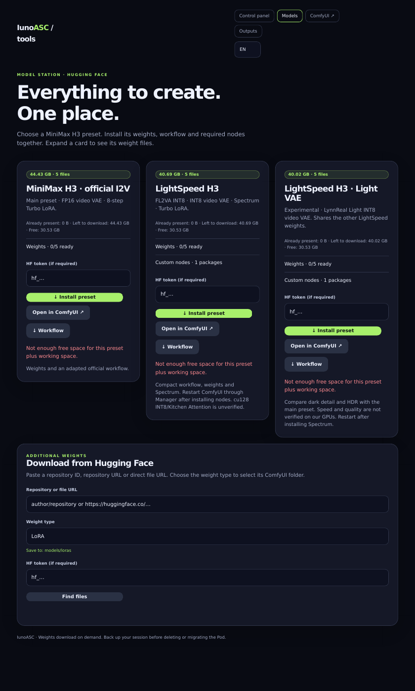
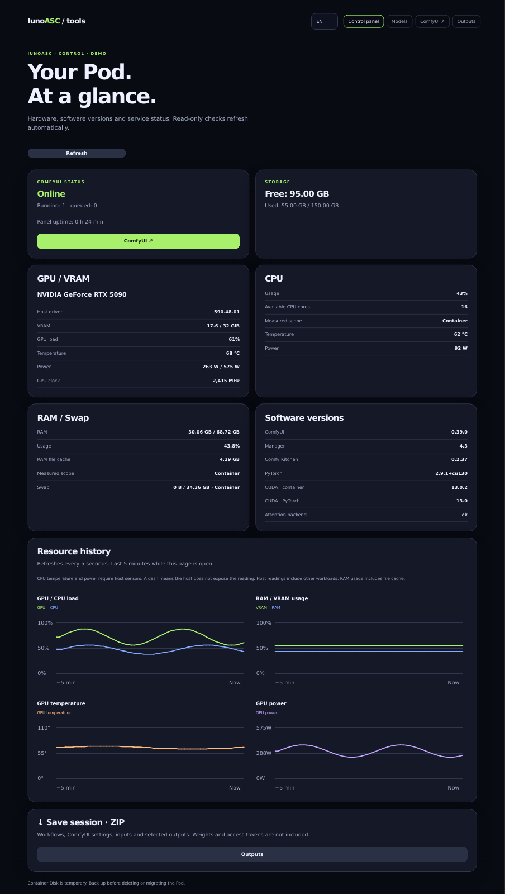
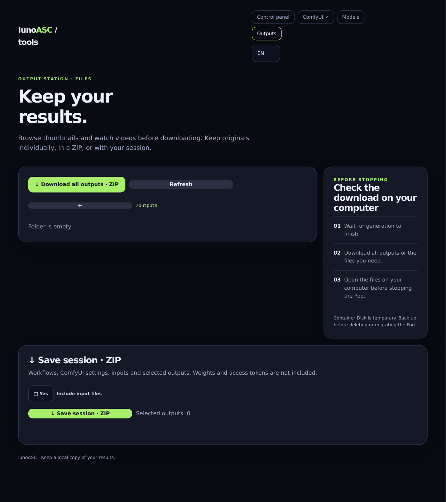

# IunoASC ComfyUI

[English](README.md) · [Русский](README.ru.md) · [Docker Hub](https://hub.docker.com/r/solozeet/comfyui/tags) · [Build status](https://github.com/solozet/IunoASC-ComfyUI/actions/workflows/build.yml)

ComfyUI for RunPod with MiniMax H3 presets, classic Manager, a model installer, live resource monitoring and a video gallery. Weights are downloaded on demand.

## Quick start

| RunPod template field | Value |
| --- | --- |
| Container image | **`solozeet/comfyui:cu130`** |
| Start Command | **Empty** |
| HTTP ports | **`3000,8081,8082,8083`** |
| Container Disk | **150 GB** recommended for the image, weights and outputs |
| Required environment variables | **None** |
| Login / password | **None** |

1. Launch the Pod. Wait for `[IunoASC] GPU preflight passed` and the ComfyUI ready message in its logs.
2. Open **Models & presets · 8081**, choose a preset and click **Install preset**.
3. After installing Spectrum for LightSpeed or the experimental preset, restart **ComfyUI through Manager**.
4. Click **Open in ComfyUI**, or select **Workflows → IunoASC**. Upload a reference image, set your prompt and start generation.
5. Open **Outputs · 8083** to watch videos, download results and save your session.

Workflows are available in the IunoASC folder from first startup. Preset installation downloads missing weights and any required custom-node package; existing workflow edits and Spectrum installations are preserved. Download progress stays at the bottom of the screen while scrolling. Repeat a failed download to resume installation with completed files reused.

## Interfaces

| HTTP port | Interface | Features |
| --- | --- | --- |
| **3000** | ComfyUI | H3 generation, workflows, classic Manager |
| **8081** | Models & presets | Preset installation, collapsible weight lists, Hugging Face downloads, progress tray |
| **8082** | Control panel | GPU/CPU, RAM/VRAM, swap, sensors, charts, disk, versions and ComfyUI queue |
| **8083** | Outputs | Video gallery, playback, file downloads, session ZIP and browser backup |

The panels support **English, Russian, German, French, Simplified Chinese and Japanese**. The language selector is on the left of the navigation links; the choice is saved in your browser and carried between panels.

Each port has its own HTTPS address: `https://POD_ID-PORT.proxy.runpod.net/`. **These endpoints have no authentication: anyone with access to their URLs can use them.** If RunPod's direct ComfyUI link returns HTTP 403, try **ComfyUI ↗** in a panel. The origin check is not password protection.

Models and presets

Control panel

The control screenshot uses example readings and is marked **DEMO**.

Outputs

## Main presets

| | Official MiniMax H3 I2V | **LightSpeed H3** |
| --- | --- | --- |
| Workflow | Adapted Comfy Org I2V example | Compact subgraph with video and LoRA controls |
| Diffusion model | FL2VA INT8 ConvRot; FP8 scaled in cu128 | FL2VA INT8 ConvRot |
| Text encoder | Qwen3-VL 32B NVFP4 AWQ | Same encoder |
| Video VAE | FP16 | **INT8 ConvRot** |
| Audio VAE | FP32 | Same audio VAE |
| LoRA | Official 8-step Turbo | Turbo v4 + optional user LoRA |
| Custom-node package installed with preset | None | **Spectrum MiniMax H3** |
| Default steps | 8 | **5** |
| Weight files | 5 | 5 |
| Weight size | **44.43 GB** with INT8; **44.41 GB** with FP8 | **40.69 GB** |

Sizes use decimal GB and cover weights only. With the cu130 official preset installed, LightSpeed downloads another **3.43 GB**: its INT8 video VAE and Turbo v4 LoRA. Both main presets together use **47.86 GB**. cu128's official preset uses a separate diffusion file.

### LightSpeed H3 — source and weights

Based on **[MiniMax H3 Ultra Fastest True 4 Steps + HD Sound | 6GB VRAM 16GB RAM [V8 Update] Lightning Speed](https://civitai.com/models/2835250?modelVersionId=3305336)** by **[RedditUser9811](https://civitai.com/user/RedditUser9811)**.

| Weight file | ComfyUI model directory | Size |
| --- | --- | ---: |
| `minimax_h3_fl2va_pruned_int8_convrot.safetensors` | `diffusion_models` | 20.97 GB |
| `qwen3vl_32b_minimax_h3_nvfp4_awq.safetensors` | `text_encoders` | 15.69 GB |
| `minimax_h3_video_vae_int8_convrot.safetensors` | `vae` | 2.81 GB |
| `minimax_h3_audio_vae_fp32.safetensors` | `vae` | 0.61 GB |
| `minimax_h3_turbo_v4_step600_ema_pruned_comfyui.safetensors` | `loras` | 0.62 GB |

The first four files come from [Comfy-Org/MiniMax-H3](https://huggingface.co/Comfy-Org/MiniMax-H3); Turbo v4 comes from [drbaph/MiniMax-H3-Turbo-Lora-ComfyUI](https://huggingface.co/drbaph/MiniMax-H3-Turbo-Lora-ComfyUI). The installer also installs [Spectrum MiniMax H3](https://github.com/xmarre/ComfyUI-Spectrum-MiniMax-H3).

### LightSpeed controls

| Control | Default / behavior |
| --- | --- |
| Prompt | Empty; editable in the compact node |
| Resolution | 9:16, 2 MP, multiple of 32; aspect ratio and dimensions on the main canvas |
| Duration / steps | **5 seconds / 5 steps** |
| FPS | **24**; also determines the supported frame count |
| Color / bit depth | **HDR / 10-bit**; SDR and other supported depths selectable |
| Turbo v4 LoRA | **Enabled, strength 1.0** |
| Additional LoRA | **Disabled**; independent file, enable switch and strength |
| Spectrum | Enabled; detailed settings inside the subgraph |
| Noise | Inside the subgraph; **randomize** |
| Reference 1 | Enabled and expanded; upload your image |
| References 2–6 | Collapsed and bypassed |
| Resolution reference table | On the main canvas |

The additional LoRA initially selects the installed Turbo file as a placeholder. An empty selection also works while the additional LoRA is disabled.

### Experimental preset: LightSpeed H3 · Light VAE

| Item | Value |
| --- | --- |
| Video VAE | `minimax_h3_lynnreal_light_vae_int8_convrot.safetensors` |
| Source | [Kijai/MiniMax-H3-experimental](https://huggingface.co/Kijai/MiniMax-H3-experimental/blob/main/minimax_h3_lynnreal_light_vae_int8_convrot.safetensors) |
| VAE size | **2.137 GB** |
| Total weights | **40.02 GB** |
| Additional download with LightSpeed installed | **2.137 GB**; the other four files are reused |
| All three presets together, cu130 | **50.00 GB** in weights |
| Workflow | `IunoASC/lightspeed-h3-light-vae.json`; LightSpeed settings |
| GPU validation | Speed, quality and HDR **not yet verified** |

## Download your own weights

Paste `author/repository`, a Hugging Face repository URL or a `blob`/`resolve` file URL. Click **Find files**, choose the file and destination type, then **Download weight**. A direct file link preselects that file. An optional HF token can be entered for repositories that require access.

| Selected type | Destination |
| --- | --- |
| LoRA — default | `models/loras` |
| Diffusion model | `models/diffusion_models` |
| Text encoder | `models/text_encoders` |
| VAE | `models/vae` |

Files are saved under their basename. **An existing non-empty file with the same name is reused, even if the repository differs.** Preset downloads also check the expected byte size. Refresh ComfyUI's model lists after downloading and select the file in the appropriate loader.

## Control panel

Readings refresh every **5 seconds**. Charts show the last **5 minutes while the page is open**.

| Area | Readings |
| --- | --- |
| GPU | Name, driver, load, used/total VRAM, temperature, power draw/limit and clock |
| CPU | Load, available cores, temperature and power when host sensors are exposed |
| Memory | Used/total RAM, file cache and swap |
| ComfyUI | Online status, running and pending jobs |
| Storage | Used, free and total disk space |
| Software | ComfyUI, Manager, Kitchen, PyTorch and container/PyTorch CUDA versions |
| Charts | GPU/CPU load, RAM/VRAM usage, GPU temperature and power |
| Warnings | RAM ≥ 90%, VRAM ≥ 95%, GPU ≥ 85 °C, free disk space < 10% |

CPU and memory readings are labelled **Container** or **Host**; host readings can include other workloads. RAM usage includes file cache. A dash indicates an unavailable sensor. Uptime describes the control-panel service.

## Outputs and backup

The folder listing refreshes every **3 seconds** without reloading the page or interrupting playback.

| Action | Result |
| --- | --- |
| Preview | Watch a video in the page |
| Video information | Resolution, FPS, codec, bit depth and color metadata |
| Download file / outputs ZIP | Save an individual file or all outputs |
| Save session · ZIP | Save workflows, UI settings, optional inputs, selected outputs and component versions |
| Browser backup | Copy output files to this browser; show saved count, size and progress |
| Red download button | Export saved browser copies even when the Pod is offline |

**Save session** excludes model weights, HF tokens and Manager configuration. Select output checkboxes and click **Save session · ZIP**. To restore, follow [Restoring a session](docs/RESTORE.md).

HDR playback requires a compatible browser, codec and display. If a preview cannot play, download the original file.

### Browser backup — emergency downloads

Keep the outputs page open while the Pod runs and wait for files to appear in **Saved in this browser**. **Only complete copies already saved locally can be downloaded after Pod termination.** You can disable automatic copying with the backup switch.

| Detail | Behavior |
| --- | --- |
| Local storage | Uses disk space on your computer |
| Scope | Bound to this Pod URL and browser profile |
| Large ZIP in Chrome/Edge | Streams to a chosen file when the save-file API is available |
| Other browsers | In-memory ZIP up to **512 MiB**; individual saved-file downloads remain available |
| Clearing site data / private browsing / browser eviction | Can remove saved copies |
| Background tab | Refreshing and copying may slow down |

Browser backup contains outputs. Use **Save session · ZIP** to also preserve workflows and settings.

## Image variants and versions

| Image suffix | NVIDIA base CUDA | PyTorch | Default attention / official diffusion | Driver required by this image |
| --- | --- | --- | --- | --- |
| **`cu130`** | **13.0.2** | **2.9.1+cu130** | Comfy Kitchen / INT8 ConvRot | ≥ 580.95.05 |
| `cu128` | 12.8.1 | 2.9.1+cu128 | Standard / FP8 scaled | ≥ 570.124.06 |
| `cu131` | 13.1.1 | 2.9.1+cu130 | Comfy Kitchen / INT8 ConvRot | ≥ 590.48.01 |
| `cu132` | 13.2.0 | 2.9.1+cu130 | Comfy Kitchen / INT8 ConvRot | ≥ 595.45.04 |

Use `solozeet/comfyui:<suffix>`. **cu131 and cu132 are experimental base variants; both use PyTorch CUDA 13.0.** Driver thresholds are this project's conservative startup policy; [technical details](docs/DEVELOPMENT.md#driver-policy). LightSpeed and Light VAE keep INT8/Kitchen settings; their **cu128 compatibility is unverified**.

Release tags such as `comfy0.39.0-cu130` and short tags are updated by rebuilds. Use an image digest to pin a particular build.

| Component | Included version |
| --- | --- |
| ComfyUI | **0.39.0** |
| ComfyUI Manager | **4.3**, classic interface |
| Comfy Kitchen | **0.2.37** |
| PyTorch / torchvision / torchaudio | **2.9.1 / 0.24.1 / 2.9.1** |

[ComfyUI 0.39.0 release notes](https://github.com/Comfy-Org/ComfyUI/releases/tag/v0.39.0) · [Development, dependencies and validation](docs/DEVELOPMENT.md)

## Storage and startup errors

| Data | Pod location |
| --- | --- |
| Models | `/data/models` |
| Inputs | `/data/inputs` |
| Outputs | `/data/outputs` |
| Workflows | `/opt/ComfyUI/user/default/workflows/IunoASC` |

**This setup uses temporary Container Disk. Save outputs and custom changes before deleting or migrating the Pod.** HF tokens entered in the downloader are not saved in configuration.

Startup preflight checks the driver, CUDA and small GPU operations before launching the services. **If it fails, the container exits but the paid RunPod allocation continues. Save the logs and stop the failing Pod yourself.** Host-driver and GPU faults require attention from the hosting provider.

The latest image builds and automated checks passed. Full H3 generation in the latest images has not yet been validated on GPU.

The adapted official workflow's MIT license is included in [workflows/LICENSE](workflows/LICENSE).
